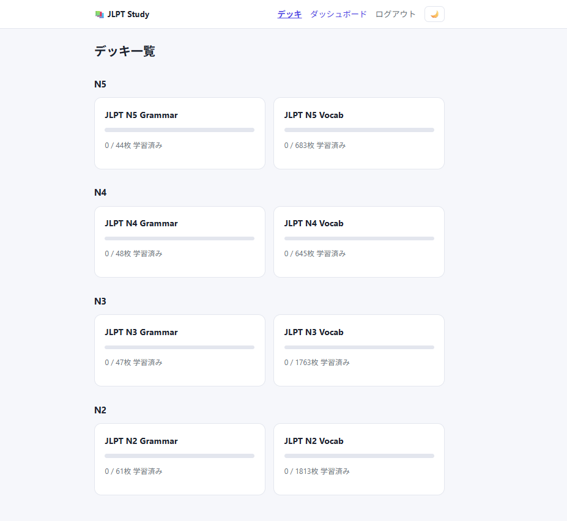
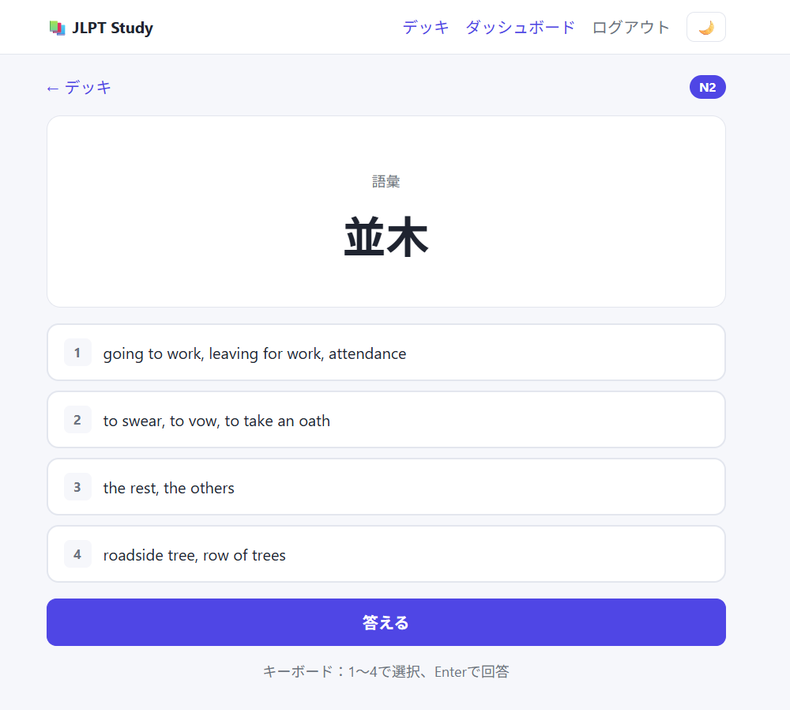
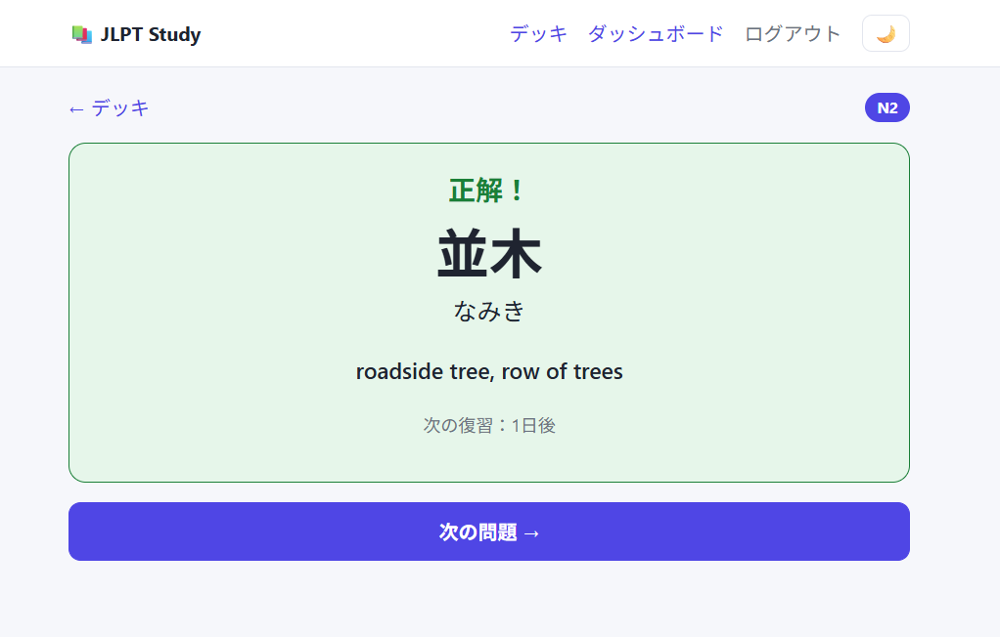
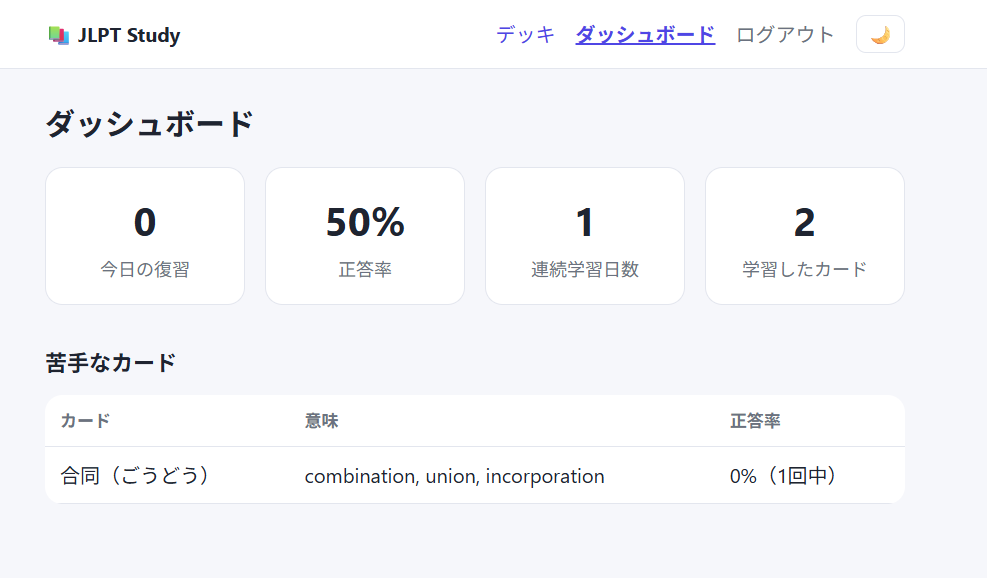
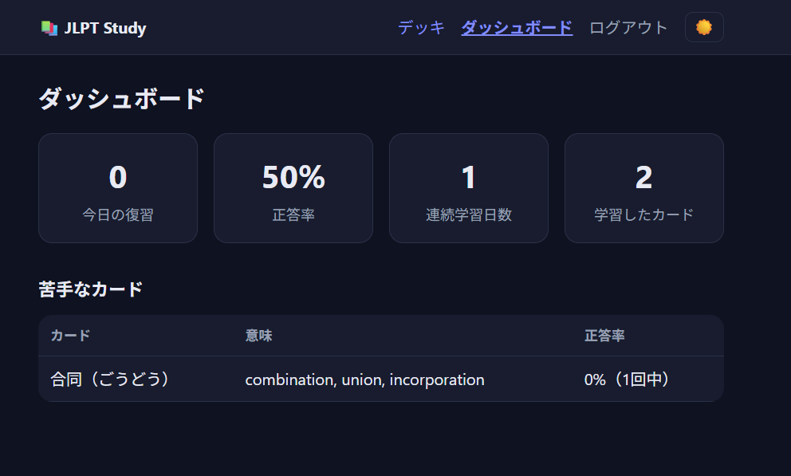
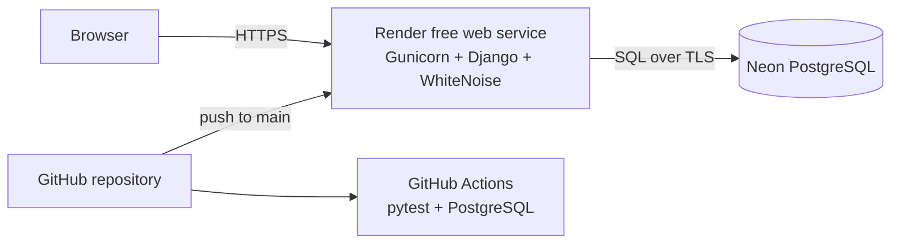

# 📚 JLPT Study

**A spaced-repetition web app for studying JLPT vocabulary and grammar (N5–N2).**
JLPT（N5〜N2）の語彙と文法を、間隔反復で学べるWebアプリ。

🔗 **Live demo / デモサイト: https://jlpt-study-app.onrender.com**


[English](#english) · [日本語](#日本語)

> ⏱️ The demo runs on a free plan and sleeps after 15 minutes without visits, so the first load can take about a minute.
> デモは無料プランのため、しばらくアクセスがないと停止します。最初の表示に1分ほどかかることがあります。

| Deck list / デッキ一覧 | Quiz / クイズ |
|---|---|
|  |  |
| **Result / 結果** | **Dashboard / ダッシュボード** |
|  |  |
| **Dark mode / ダークモード** | |
|  | |

---

## English

### Features

- **Accounts:** sign up, log in, and keep your own progress
- **Content:** about 4,900 vocabulary words and 200 grammar points (N5 to N2), grouped into decks
- **Multiple-choice quiz** with four options that never repeat the same meaning; keyboard shortcuts (`1`–`4` to choose, `Enter` to answer)
- **Spaced repetition:** a simplified SM-2 scheduler decides when each card comes back (due cards first, then new ones)
- **Dashboard:** cards due today, accuracy, study streak (in Tokyo time), cards studied, and your five weakest cards
- **REST API** for decks, questions, answers, and stats
- **Japanese UI** with a light/dark theme toggle that remembers your choice

### Tech stack

| Area | Tools |
|---|---|
| Backend | Python 3.13, Django, Django REST Framework |
| Database | PostgreSQL (Docker Compose locally, Neon in production) |
| Testing | pytest, pytest-django |
| CI | GitHub Actions (tests run against a real PostgreSQL service) |
| Hosting | Render (web service), Neon (database), WhiteNoise + Gunicorn |
| Config | django-environ, `.env` files, `render.yaml` Blueprint |

### Architecture



```
config/       settings, URLs, sign-up view
cards/        Deck and Card models, quiz choice logic, import_cards command
reviews/      Answer and Review models, SM-2 scheduler, services, dashboard stats
api/          REST endpoints (Django REST Framework)
templates/    Django templates (Japanese UI)
static/css/   stylesheet with light and dark themes
data/         vocabulary and grammar CSV files, with attribution
```

### How the spaced repetition works

Each answer updates a `Review` record for that user and card (ease factor, interval, repetitions, due date):

| Answer | Next interval | Ease factor |
|---|---|---|
| 1st correct | 1 day | unchanged |
| 2nd correct | 6 days | unchanged |
| 3rd or later correct | previous interval × ease factor | unchanged |
| Wrong | reset to 1 day | −0.32 (minimum 1.3) |

The ease factor starts at 2.5. The scheduler lives in `reviews/scheduler.py` as a pure function with no Django imports, so it is covered by fast unit tests.

### Run it locally

You need Python 3.13, Git, and Docker Desktop (for PostgreSQL).

```bash
git clone https://github.com/Zabu-Kyaw/jlpt-study-app.git
cd jlpt-study-app

python -m venv .venv
source .venv/bin/activate          # Windows PowerShell: .venv\Scripts\activate
pip install -r requirements.txt

cp .env.example .env               # Windows: copy .env.example .env
docker compose up -d               # starts PostgreSQL

python manage.py migrate
python manage.py createsuperuser
python manage.py import_cards data/jlpt_n5_n2_vocab.csv
python manage.py import_cards data/jlpt_n5_n2_grammar.csv
python manage.py runserver
```

Open http://127.0.0.1:8000/. If port 5432 is already in use on your machine, change the port mapping in `docker-compose.yml` and the port in `DATABASE_URL` to match.

### Run the tests

```bash
docker compose up -d
python -m pytest
```

The tests cover the scheduler, quiz logic, the CSV importer, views, the dashboard statistics, sign-up, and the REST API.

### Configuration

| Variable | Purpose |
|---|---|
| `SECRET_KEY` | Django secret key (required) |
| `DEBUG` | `True` for local development, `False` in production |
| `DATABASE_URL` | PostgreSQL connection string |
| `PRODUCTION` | `True` enables secure cookies and the proxy HTTPS header |
| `ALLOWED_HOSTS`, `CSRF_TRUSTED_ORIGINS` | Optional comma-separated lists (Render's host name is added automatically) |

### REST API

The API uses session authentication, so you must be logged in.

| Method | Endpoint | Description |
|---|---|---|
| GET | `/api/decks/` | List decks with card counts |
| GET | `/api/decks/<id>/next/` | Next question with four choices |
| POST | `/api/answers/` | Submit `{"card": <id>, "choice": <id>}` |
| GET | `/api/stats/` | Dashboard statistics |

The API is stateless: the client sends the card and the chosen option, and the **server** decides whether the answer is correct.

### Deployment

The app is described by `render.yaml` (a Render Blueprint). On each push to `main`, Render runs `collectstatic`, `migrate`, and the two `import_cards` commands, then starts Gunicorn. The database is a free Neon PostgreSQL project, because Render's own free database expires after 30 days. Secrets (`SECRET_KEY`, `DATABASE_URL`) are environment variables and are never committed.

### Design decisions

- **Business logic is kept out of views.** The scheduler, quiz choice builder, and stats are plain modules that the web views and the REST API both reuse, so the two cannot drift apart.
- **Idempotent, batched importer.** `import_cards` matches cards on word and reading (so words like 年 keep their different readings), can be re-run safely, and writes in batches so deploys stay fast.
- **Answers are not exposed in the page.** The correct card ID is stored in the server-side session, and refreshing the result page cannot record an answer twice.
- **Quiz options are checked for duplicates**, so two choices never share the same meaning.

### Data and licensing

- **Vocabulary lists and JLPT levels:** Jonathan Waller, [tanos.co.uk/jlpt](https://www.tanos.co.uk/jlpt/), licensed [CC BY](https://creativecommons.org/licenses/by/4.0/).
- **English meanings:** [JMdict](https://www.edrdg.org/jmdict/j_jmdict.html) © the [Electronic Dictionary Research and Development Group](https://www.edrdg.org/), used under the [EDRDG licence](https://www.edrdg.org/edrdg/licence.html) (CC BY-SA 4.0). Each word shows its primary sense.
- **Grammar patterns, meanings, and example sentences:** original content written for this project.
- **Code:** MIT License (see `LICENSE`). The vocabulary CSV is a derived dataset shared under CC BY-SA 4.0. See [`data/README.md`](data/README.md) for details.

The JLPT does not publish official vocabulary or grammar lists, so the levels here are a community reconstruction and should be treated as a guide. Corrections to the grammar examples are welcome through issues.

### Ideas for next steps

- Fill-in-the-blank grammar quiz using the example sentences
- Example sentences for vocabulary (for instance from Tatoeba)
- A four-level rating (again / hard / good / easy) instead of correct / wrong
- Reading and listening quiz modes, and kanji decks
- Password reset by email and a profile page

### Author

**Za Bu Kyaw (Steven)** · [GitHub](https://github.com/Zabu-Kyaw) · [LinkedIn](https://www.linkedin.com/in/zabukyaw)

---

## 日本語

### 概要

JLPT（日本語能力試験）N5〜N2の語彙と文法を、間隔反復（スペースドリピティション）で学べるWebアプリです。DjangoとPostgreSQLで作り、RenderとNeonで公開しています。

### 主な機能

- **アカウント:** 新規登録とログインで、自分の学習記録を保存
- **コンテンツ:** N5〜N2の語彙（約4,900語）と文法（200項目）をデッキごとに収録
- **4択クイズ:** 同じ意味の選択肢が重ならないように作成。キーボードで操作可能（`1`〜`4`で選択、`Enter`で回答）
- **間隔反復:** 簡易版SM-2アルゴリズムが次の復習日を計算（復習期限のカードを優先し、その後に新しいカード）
- **ダッシュボード:** 今日の復習数、正答率、連続学習日数（東京時間）、学習したカード数、苦手なカード上位5件
- **REST API:** デッキ、問題、回答、統計に対応
- **日本語UI:** ライト／ダークモードの切り替えと、選択の保存

### 技術スタック

| 分野 | 使用技術 |
|---|---|
| バックエンド | Python 3.13、Django、Django REST Framework |
| データベース | PostgreSQL（ローカルはDocker Compose、本番はNeon） |
| テスト | pytest、pytest-django |
| CI | GitHub Actions（実際のPostgreSQLに対してテストを実行） |
| ホスティング | Render（Webサービス）、Neon（データベース）、WhiteNoise、Gunicorn |
| 設定管理 | django-environ、`.env`ファイル、`render.yaml`（Blueprint） |

### アーキテクチャ

上の英語セクションの図とディレクトリ構成を参照してください。

### 間隔反復の仕組み

回答するたびに、ユーザーとカードごとの`Review`レコード（易しさ係数、間隔、連続正解回数、次回の期限）を更新します。

| 回答 | 次の復習までの間隔 | 易しさ係数 |
|---|---|---|
| 1回目の正解 | 1日 | 変化なし |
| 2回目の正解 | 6日 | 変化なし |
| 3回目以降の正解 | 前回の間隔 × 易しさ係数 | 変化なし |
| 不正解 | 1日にリセット | 0.32下がる（最小1.3） |

易しさ係数の初期値は2.5です。スケジューラーは`reviews/scheduler.py`にあり、Djangoに依存しない純粋な関数なので、高速なユニットテストで検証しています。

### ローカルでの起動方法

Python 3.13、Git、Docker Desktop（PostgreSQL用）が必要です。

```bash
git clone https://github.com/Zabu-Kyaw/jlpt-study-app.git
cd jlpt-study-app

python -m venv .venv
source .venv/bin/activate          # Windows PowerShellの場合: .venv\Scripts\activate
pip install -r requirements.txt

cp .env.example .env               # Windowsの場合: copy .env.example .env
docker compose up -d               # PostgreSQLを起動

python manage.py migrate
python manage.py createsuperuser
python manage.py import_cards data/jlpt_n5_n2_vocab.csv
python manage.py import_cards data/jlpt_n5_n2_grammar.csv
python manage.py runserver
```

http://127.0.0.1:8000/ を開いてください。ポート5432がすでに使われている場合は、`docker-compose.yml`のポート設定と`DATABASE_URL`のポート番号を同じ値に変更してください。

### テストの実行

```bash
docker compose up -d
python -m pytest
```

スケジューラー、クイズのロジック、CSVインポーター、ビュー、ダッシュボードの統計、新規登録、REST APIをテストしています。

### REST API

セッション認証を使うため、ログインが必要です。

| メソッド | エンドポイント | 内容 |
|---|---|---|
| GET | `/api/decks/` | カード数つきのデッキ一覧 |
| GET | `/api/decks/<id>/next/` | 4択の次の問題 |
| POST | `/api/answers/` | `{"card": <id>, "choice": <id>}`を送信 |
| GET | `/api/stats/` | ダッシュボードの統計 |

APIはステートレスです。クライアントはカードと選んだ選択肢を送り、正誤の判定は**サーバー**が行います。

### デプロイ

`render.yaml`（Render Blueprint）で構成を定義しています。`main`にプッシュするたびに、Renderが`collectstatic`、`migrate`、2つの`import_cards`を実行し、Gunicornを起動します。データベースにはNeonの無料PostgreSQLを使っています。Render標準の無料データベースは30日で期限切れになるためです。秘密情報（`SECRET_KEY`、`DATABASE_URL`）は環境変数で管理し、リポジトリにはコミットしていません。

### 設計上の工夫

- **ビューにロジックを置かない:** スケジューラー、選択肢の生成、統計は独立したモジュールにし、WebビューとREST APIの両方から再利用しています。
- **冪等でバッチ処理のインポーター:** 単語と読みの組み合わせで照合するため、「年」のように複数の読みを持つ語も保持できます。何度実行しても安全で、バッチ書き込みによりデプロイも高速です。
- **正解をページに出さない:** 正解のカードIDはサーバー側のセッションに保存し、結果ページを再読み込みしても二重に記録されません。
- **選択肢の重複チェック:** 同じ意味の選択肢が2つ並ばないようにしています。

### データとライセンス

- **語彙リストとJLPTレベル:** Jonathan Waller氏（[tanos.co.uk/jlpt](https://www.tanos.co.uk/jlpt/)）、[CC BY](https://creativecommons.org/licenses/by/4.0/)
- **英語の意味:** [JMdict](https://www.edrdg.org/jmdict/j_jmdict.html) © [電子辞書研究開発グループ（EDRDG）](https://www.edrdg.org/)、[EDRDGライセンス](https://www.edrdg.org/edrdg/licence.html)（CC BY-SA 4.0）に基づいて使用。各語の第一義を表示しています。
- **文法項目・意味・例文:** このプロジェクトのために作成したオリジナルです。
- **コード:** MITライセンス（`LICENSE`を参照）。語彙CSVは派生データセットとして、CC BY-SA 4.0で公開しています。詳細は[`data/README.md`](data/README.md)を参照してください。

JLPTは公式の語彙・文法リストを公開していないため、ここでのレベルはコミュニティによる再構成であり、目安としてお使いください。文法の例文への修正提案は、Issueでお待ちしています。

### 今後の予定

- 例文を使った文法の穴埋めクイズ
- 語彙の例文（Tatoebaなどを活用）
- 「正解／不正解」ではなく4段階評価（もう一度／難しい／普通／簡単）
- 読み・聞き取りクイズ、漢字デッキ
- メールでのパスワード再設定とプロフィールページ

### 作者

**Za Bu Kyaw (Steven)** · [GitHub](https://github.com/Zabu-Kyaw) · [LinkedIn](https://www.linkedin.com/in/zabukyaw)
